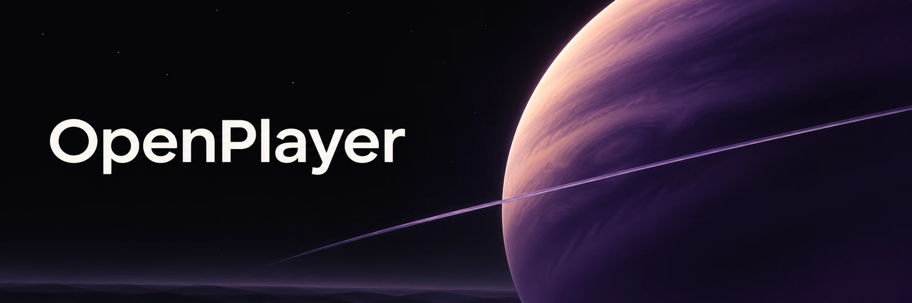
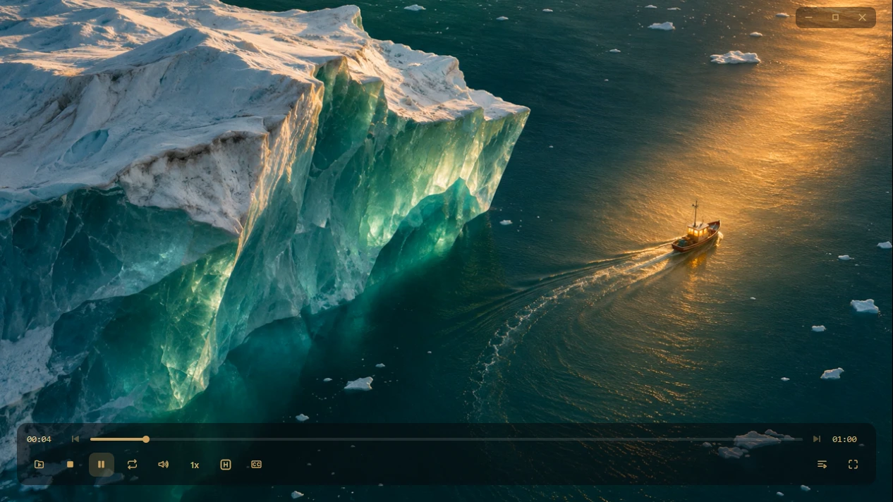
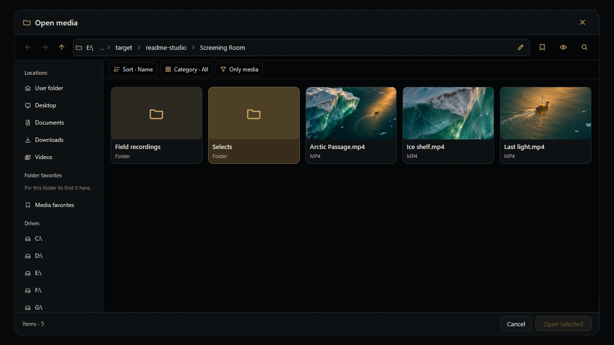

<p align="center"></p>

<p align="center"><strong>An open-source desktop player for video and audio, built with Rust and libmpv.</strong></p>
<p align="center"><a href="https://github.com/AreChen/OpenPlayer/releases/latest">Download OpenPlayer</a> · <a href="https://player.playones.com/">Website</a> · <a href="README.zh-CN.md">简体中文</a> · <a href="docs/architecture/README.md">Architecture</a> · <a href="LICENSE">MIT license</a></p>

## Watch

Open a film and the window fits its frame, including portrait footage. Move the pointer out of the picture and the controls disappear. Bring it back to scrub, switch tracks or step through individual frames.



## Browse

Double-click the empty window to browse. Jump straight to a path, pin a folder, or save individual titles to Media favorites. Videos have thumbnails and silent hover previews. Search includes subfolders, and the browser remembers your last folder, sorting and filters.



Both screenshots show the released Windows player running in English. The cover and the sample footage were created for this project. [Image credits](docs/assets/readme/credits.md)

## Get OpenPlayer 2.0.1

| Platform | Download |
| --- | --- |
| Windows x64 | [Windows installer](https://github.com/AreChen/OpenPlayer/releases/download/v2.0.1/OpenPlayer_2.0.1_x64-setup.exe) |
| macOS | [Apple Silicon DMG](https://github.com/AreChen/OpenPlayer/releases/download/v2.0.1/OpenPlayer_2.0.1_arm64.dmg) · [Intel DMG](https://github.com/AreChen/OpenPlayer/releases/download/v2.0.1/OpenPlayer_2.0.1_x64.dmg) |
| Linux x64 | [Debian package](https://github.com/AreChen/OpenPlayer/releases/download/v2.0.1/OpenPlayer_2.0.1_amd64.deb) · [AppImage](https://github.com/AreChen/OpenPlayer/releases/download/v2.0.1/OpenPlayer_2.0.1_amd64.AppImage) |

**Settings → About** checks for stable releases in the installed major version, downloads the matching package and verifies its SHA-256. The release includes a checksum for each installer. [Release notes and checksums](https://github.com/AreChen/OpenPlayer/releases/tag/v2.0.1)

## Play from source

On `main`, Windows, macOS and Linux share a GPUI Fast interface written in Rust. Windows presents video through D3D11. The macOS and Linux builds use libmpv's software render API to place frames in the GPUI scene.

Install Rust 1.100.0 and the libmpv development files for your platform, then run this from the repository root. [Build prerequisites](docs/architecture/README.md#build)

```sh
cargo run --locked -p openplayer-desktop -- "/path/to/your/video.mp4"
```

[Rust plugin SDK](docs/plugins/native-sdk.md) · [Official plugins](https://github.com/AreChen/openplayer-plugins/tree/main/native) · [Playback and window checks](docs/architecture/regression-checks.md) · [Native dependencies](docs/native-deps/README.md) · [Report an issue](https://github.com/AreChen/OpenPlayer/issues)
