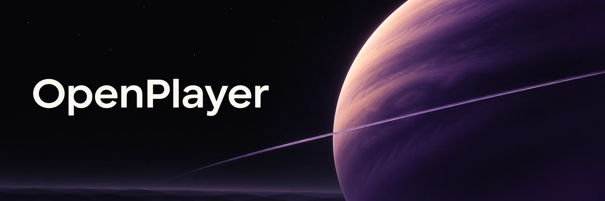
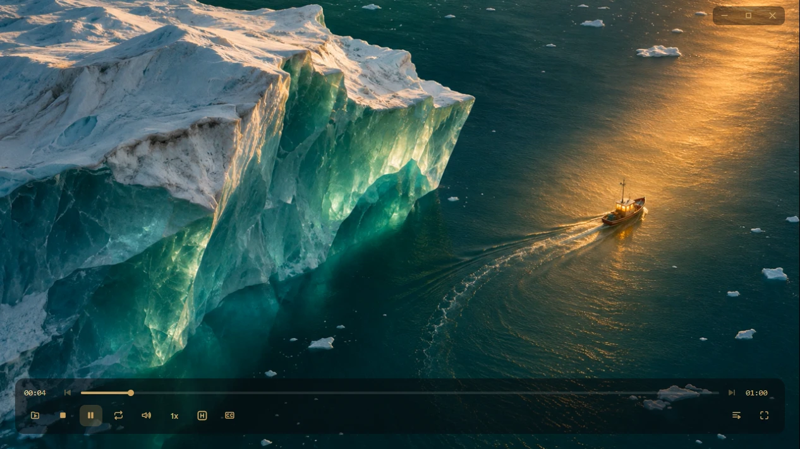
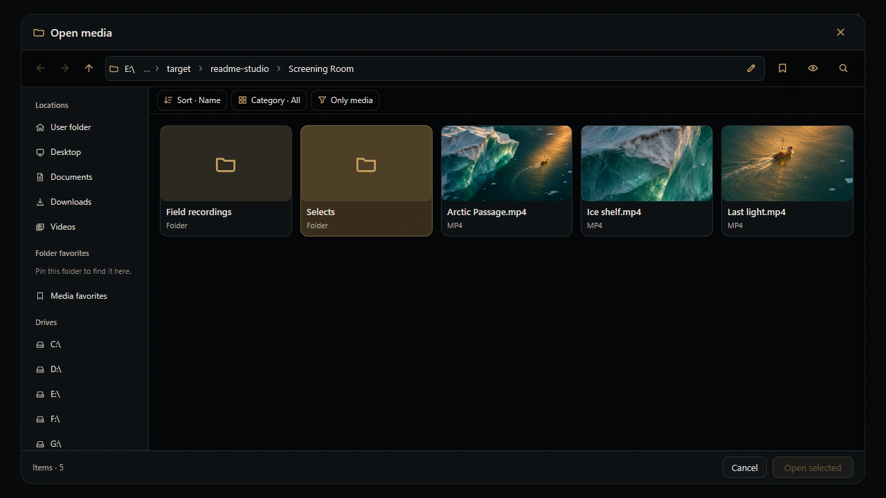

<p align="center"></p>

<p align="center"><strong>用 Rust 和 libmpv 构建的开源桌面影音播放器。</strong></p>
<p align="center"><a href="https://github.com/AreChen/OpenPlayer/releases/latest">下载 OpenPlayer</a> · <a href="https://player.playones.com/">官网</a> · <a href="README.md">English</a> · <a href="docs/architecture/README.md">项目架构</a> · <a href="LICENSE">MIT 许可证</a></p>

## 播放

打开影片，窗口随画幅调整，竖屏视频也能贴合窗口。鼠标移开，画面就留给影片。移回窗口，可以拖动进度、切换音轨和字幕，也可以逐帧查看。



## 浏览

双击空白窗口打开媒体浏览器。可以直接输入路径、收藏常用目录，也可以只收藏某一部影片。视频卡片支持缩略图和悬停静音预览，搜索会遍历子目录。下次打开时，浏览器会恢复上次的目录、排序和筛选。



两张截图均来自 Windows 正式版的英文界面。封面和演示影片素材为本项目生成。[图像来源](docs/assets/readme/credits.md)

## 下载 OpenPlayer 2.0.1

| 平台 | 安装包 |
| --- | --- |
| Windows x64 | [Windows 安装程序](https://github.com/AreChen/OpenPlayer/releases/download/v2.0.1/OpenPlayer_2.0.1_x64-setup.exe) |
| macOS | [Apple Silicon DMG](https://github.com/AreChen/OpenPlayer/releases/download/v2.0.1/OpenPlayer_2.0.1_arm64.dmg) · [Intel DMG](https://github.com/AreChen/OpenPlayer/releases/download/v2.0.1/OpenPlayer_2.0.1_x64.dmg) |
| Linux x64 | [Debian 安装包](https://github.com/AreChen/OpenPlayer/releases/download/v2.0.1/OpenPlayer_2.0.1_amd64.deb) · [AppImage](https://github.com/AreChen/OpenPlayer/releases/download/v2.0.1/OpenPlayer_2.0.1_amd64.AppImage) |

在**设置 → 关于**中可以检查当前主版本的稳定更新、下载匹配的安装包并校验 SHA-256。发布页也提供了每个安装包的校验文件。[版本说明与校验文件](https://github.com/AreChen/OpenPlayer/releases/tag/v2.0.1)

## 从源码运行

`main` 上的 Windows、macOS 和 Linux 共用 Rust 编写的 GPUI Fast 界面。Windows 通过 D3D11 合成视频，macOS 和 Linux 使用 libmpv 软件渲染接口将视频帧放入 GPUI 窗口。

安装 Rust 1.100.0 和对应平台的 libmpv 开发文件后，在仓库根目录运行以下命令。[构建依赖](docs/architecture/README.md#build)

```sh
cargo run --locked -p openplayer-desktop -- "/path/to/your/video.mp4"
```

[Rust 插件 SDK](docs/plugins/native-sdk.md) · [官方插件](https://github.com/AreChen/openplayer-plugins/tree/main/native) · [播放与窗口验证](docs/architecture/regression-checks.md) · [原生依赖与许可](docs/native-deps/README.md) · [反馈问题](https://github.com/AreChen/OpenPlayer/issues)
